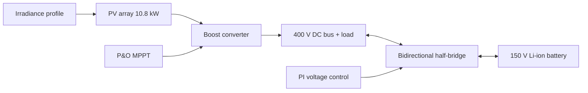

# ☀️🔋 SolarVault: BESS using Solar PV Array

A 24-hour solar day compressed into 24 seconds: a PV array with **P&O MPPT**, a **boost converter**, a DC bus and a **bidirectional half-bridge converter** that charges and discharges a Li-ion battery. Built in MATLAB/Simulink (Simscape Electrical).

  

---

## 1. System Overview

A 2-stage DC-DC architecture for renewable microgrids:

1. **Stage 1: Boost converter + MPPT.** Steps the PV voltage (~270 V at MPP) up to the DC bus (400 V reference). A Perturb & Observe algorithm adjusts the duty ratio to extract maximum PV power.
2. **Stage 2: Bidirectional half-bridge converter.** Controlled by a PI loop on the bus voltage. It operates in **buck mode** to charge the battery when PV power is in surplus, and in **boost mode** to discharge the battery when PV is low or absent (night).



---

## 2. System Parameters

| Block | Parameter | Value |
|---|---|---|
| PV array | Max power | 10.8 kW (1000 W/m², 25 °C) |
| | Voc / Isc | 300 V / 41.2 A |
| | Vmp / Imp | 270 V / 40 A |
| | Cell temperature | 25 °C (constant) |
| Boost converter | Switching frequency | 10 kHz |
| | Initial duty | 1 − 270/400 ≈ 0.325 |
| DC bus | Reference voltage | 400 V |
| | Load resistor | [40 Ω] (~4 kW at 400 V) |
| Half-bridge | Battery-side duty (D = Vbatt/Vbus) | ≈ 0.375 |
| Battery | Type / nominal voltage | Li-ion / 150 V |
| | Capacity | 0.0139 Ah (50 Ah / 3600, time-scaled) |
| | Initial SOC | 50 % |
| | Response time | 0.1 s |
| Solver | powergui | Discrete, 2e-6 s |

---

## 3. The "Day in 24 Seconds" Idea

The irradiance profile (`irradiance_profile.m`) is a `[time, W/m²]` array where **1 s of simulation = 1 hour**. It is zero at night, starts at 20 W/m² at hour 5, peaks at **1000 W/m² at hour 13** and returns to zero by hour 22. To make SOC visibly change in 24 s, the battery capacity is scaled by 1/3600.

---

## 4. MPPT: Perturb & Observe

`MPPT_PO.m` runs every **5 ms** (slower than the converter dynamics):

1. Averages Vpv and Ipv over the 5 ms window to remove switching ripple.
2. Computes P = V·I, dV and dP against the previous update.
3. For a boost converter, raising D lowers Vpv, so:
   - power up and voltage up → **decrease D**
   - power down and voltage up → **increase D**
4. Step size ΔD = 0.002, D limited to 0.25 – 0.60, direction reverses at a limit.
5. When P < 1 W (night), D resets to 0.325.

Dmppt is converted to gate pulses through a **PWM Generator (DC-DC)** block at 10 kHz.

---

## 5. Results

| Plot | Observation |
|---|---|
| Dmppt | Tracks irradiance through the day, held at 0.325 at night |
| Vpv / Vboost | PV voltage follows the MPP while the boost output rises with the PV power |
| Battery | Current is negative (charging) in daylight, SOC rises from ~51.6 % to ~53.6 % |

*(Add screenshots in `results/` and link them here: ``)*

---

## 6. Challenges and Lessons Learned

- **MPPT saturated at its duty limit** because it ran at the solver step (microseconds). Fix: a slow 5 ms update with averaging.
- **Sample time must match powergui.** A wrong `Ts` in the code changed the MPPT update rate from 5 ms to 0.5 s.
- **A PWM needs enough samples per switching cycle.** A 20 kHz sawtooth with a 50 µs solver step could not form a duty cycle. The fix was a smaller powergui step.
- **Duty limits must agree with the bus voltage.** Vpv = Vbus × (1 − D), so D cannot go below 1 − Voc/Vbus ≈ 0.25.
- **P&O under changing irradiance** can misread an irradiance-driven power rise as the effect of its own perturbation.

---

## 7. Known Limitations and Future Work

- The DC bus is **not yet held at 400 V**. It varies from about 140 V (night) to about 600 V (peak sun) because the battery stage current is limited and the PI loop needs retuning.
- Add a bus overvoltage limit so the MPPT backs off when the battery cannot absorb more.
- Add a bus capacitor sized for the ripple requirement and retune the PI gains.
- Try Incremental Conductance MPPT and compare it with P&O.
- Add a variable load profile and a realistic battery capacity (without time scaling).

---

## 8. How to Run

1. Open `model/pv_boost_battery.slx` in MATLAB/Simulink (Simscape Electrical required).
2. Run `code/irradiance_profile.m` to create `irradianceprofile` in the workspace.
3. Set the stop time to **24 s**, powergui to Discrete 2e-6 s.
4. Click **Run** and open the scopes.

---

## 9. Repository Structure

```
SolarVault/
├── README.md
├── model/        # Simulink model (.slx)
├── code/         # MPPT_PO.m, irradiance_profile.m
├── results/      # scope screenshots
└── docs/         # design_notes.md, block diagram
```

## 10. Applications

- Solar PV energy storage systems (ESS)
- EV charging stations with V2G capability
- UPS and data-center DC backup
- Renewable energy microgrids

## 11. Concepts Demonstrated

- Two-stage decoupled converter architecture
- MPPT (Perturb & Observe) for a boost converter
- Bidirectional buck/boost battery interface
- Closed-loop PI voltage control
- Time-scaled simulation of a daily solar cycle

---

## License

MIT License
